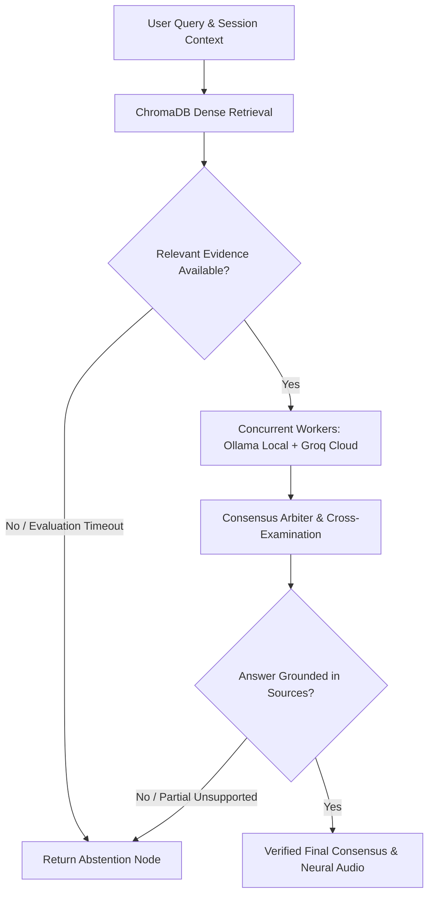

# 🤖 RagObot: Multi-Agent Concurrent RAG Matrix
**Built by Bimal P B**

[](https://github.com/Bimal-Prakash/RagObot/actions/workflows/ci.yml)
[](LICENSE)
[](https://www.python.org/downloads/)
[](https://fastapi.tiangolo.com)
[](https://github.com/langchain-ai/langgraph)
[](https://react.dev)

RagObot is a production-conscious, multi-agent Retrieval-Augmented Generation (RAG) system built on **LangGraph**. It orchestrates local compute (**Ollama**) and cloud compute (**Groq LPU**) concurrently, verifies retrieved evidence with a fail-closed consensus arbiter, enforces strict factual grounding boundaries, and streams real-time events over Server-Sent Events (SSE) to a futuristic **React Cyber-Console**.

---

## 🗺️ System Architecture



---

## 🛡️ Open-Source Security & Grounding Guarantees

1. **Header-Only Developer Diagnostic Authorization**:
   - Secrets (`DEV_MODE_KEY`) are accepted **exclusively** via HTTP headers (`X-Dev-Key` or `Authorization: Bearer`).
   - Query parameters and request body fields containing developer keys are strictly rejected to prevent secret leakage in server logs, reverse-proxy access logs, and browser history.
   - When running in `ENVIRONMENT=production`, diagnostic mode cannot be bypassed without key validation even if local debug flags are set.

2. **Strict Public vs. Diagnostic Response Schemas**:
   - **Public Mode (Default)**: Emits only verified public fields (`id`, `role`, `content`, `timestamp`, `sources`, `evidenceAvailable`, `answerGrounded`, `isAbstained`). Internal model reasoning, raw candidate worker drafts (`ollamaStream`, `groqStream`), arbiter debate transcripts, and grounding reasons are completely excluded from the payload.
   - **Developer Mode**: Enabled only when explicitly requested and authenticated via header. Grants full visibility into worker drafts, debate resolution, and token metrics.

3. **Multi-Stage Fail-Closed Grounding**:
   - **Evidence Gate**: Evaluates semantic similarity and relevance. If chunks fall below threshold or the evaluator emits ambiguous verdicts, the system fails closed to `return_abstention`.
   - **Prompt-Injection Isolation**: Retrieved source texts and worker drafts are quarantined inside boundary delimiters (`<untrusted_source_evidence>`) before reaching the arbiter.
   - **Deterministic Numeric & Date Validator**: Extracts numerical metrics, dates, and percentages from synthesized text and verifies their literal presence in source documents. Hallucinated numbers trigger immediate rejection.

4. **Upload & Path Traversal Hardening**:
   - Thread IDs are strictly validated against `^[a-zA-Z0-9_\-]{1,64}$` to prevent directory traversal and file injection.
   - Uploaded files are sanitized to their base names, restricted to allowlisted extensions (`.md`, `.markdown`, `.txt`, `.pdf`), and capped at 25 MB.

5. **Cross-Platform Compatibility**:
   - Runs natively on Linux, macOS, and Windows. Windows-specific APIs (`pywin32`, Windows MCI) are conditionally loaded with automatic graceful fallbacks to Microsoft Edge Neural TTS.

---

## 🚀 Quickstart

### Prerequisites
- **Python 3.11+**
- **Node.js 20+**
- *(Optional)* [Ollama](https://ollama.com/) running locally for offline inference (`ollama run llama3.2`).
- *(Optional)* [Groq API Key](https://console.groq.com/) for high-speed cloud LPU reasoning.

### 1. Clone & Set Up Python Environment

```bash
git clone https://github.com/Bimal-Prakash/RagObot.git
cd RagObot

# Create virtual environment
python -m venv .venv

# Activate virtual environment
# Windows (PowerShell):
.venv\Scripts\Activate.ps1
# Windows (cmd):
.venv\Scripts\activate.bat
# Linux / macOS:
source .venv/bin/activate

# Install backend dependencies
pip install -r requirements.txt
```

### 2. Configure Environment

Copy `.env.example` to `.env`:
```bash
# Windows
copy .env.example .env
# Linux / macOS
cp .env.example .env
```
Edit `.env` to configure your API keys and model preferences.

### 3. Start the Backend API

```bash
python -m uvicorn api:app --reload --host 127.0.0.1 --port 8000
```
API docs will be available at [http://127.0.0.1:8000/docs](http://127.0.0.1:8000/docs).

### 4. Start the React Frontend

In a separate terminal:
```bash
cd frontend
npm install
npm run dev
```
Open **`http://localhost:5173`** in your browser.

*(Optional)* You can also run the interactive Rich terminal console anytime:
```bash
python main.py
```

---

## ⚙️ Configuration Reference

All settings can be configured via environment variables or `.env`:

| Variable | Default | Description |
|---|---|---|
| `ENVIRONMENT` | `development` | Deployment environment (`development`, `staging`, `production`). |
| `HOST` | `127.0.0.1` | Network interface to bind the FastAPI server. |
| `PORT` | `8000` | Port for the FastAPI server. |
| `ALLOWED_ORIGINS` | `http://localhost:5173,...` | Comma-delimited list of allowed CORS origins. |
| `DEV_MODE_KEY` | *(empty)* | Secret key required to access developer diagnostic mode. |
| `ALLOW_UNAUTHENTICATED_DEV_MODE` | `false` | Allows dev mode without a key in non-production environments. |
| `GROQ_API_KEY` | *(empty)* | API key for Groq cloud LPU inference. |
| `GROQ_MODEL` | `llama-3.3-70b-versatile` | Cloud model identifier for Groq. |
| `OLLAMA_BASE_URL` | `http://localhost:11434` | Endpoint for local Ollama instance. |
| `OLLAMA_MODEL` | `llama3.2` | Local model tag for Ollama. |
| `EMBEDDING_MODEL` | `nomic-embed-text` | ChromaDB dense embedding model. |
| `ARBITER_ENGINE` | `groq` | Engine used for arbitration (`groq` or `ollama`). |
| `MAX_CONTEXT_TOKENS` | `3500` | Context window token budget before automated trimming. |
| `TOP_K_CHUNKS` | `5` | Maximum semantic chunks retrieved per query. |
| `CHUNK_SIZE` | `1000` | Character size for dense text chunking. |
| `CHUNK_OVERLAP` | `150` | Character overlap between consecutive chunks. |
| `TTS_ENABLED` | `true` | Enables speech synthesis backend. |
| `TTS_VOICE` | `en-US-JennyNeural` | Voice identifier for Microsoft Edge Neural TTS. |

---

## 📡 API Reference

### Core Endpoints

- `POST /api/query`: SSE streaming endpoint executing LangGraph multi-agent execution. Emits `docs`, `ollama_token`, `groq_token`, `evidence_status`, `validation_status`, and `consensus`.
- `POST /api/upload`: Uploads and parses markdown, text, or PDF documents into ChromaDB.
- `GET /api/models`: Returns available local Ollama and cloud Groq models.
- `GET /api/status`: Returns runtime metrics, context token consumption, and model availability.
- `GET /api/threads`: Lists saved chat threads.
- `GET /api/threads/{thread_id}`: Retrieves complete chat history. Provide `X-Dev-Key` or `Authorization: Bearer <key>` with `?dev_mode=true` to view internal diagnostic drafts and debate logs.
- `POST /api/threads`: Creates a new conversation thread.
- `PUT /api/threads/{thread_id}`: Updates thread title.
- `DELETE /api/threads/{thread_id}`: Deletes a conversation thread.
- `POST /api/voice/synthesize`: Synthesizes expressive neural audio (MP3) for browser streaming.

---

## 🧪 Testing & Verification

RagObot includes a comprehensive automated test suite with 47+ deterministic tests verifying:
- Prompt injection isolation
- Evaluator verdict consistency & fail-closed behavior
- Deterministic claim and numeric validator
- Header-only developer authorization & schema filtering
- Path traversal & upload payload validation
- Cross-platform TTS fallbacks

Run the backend test suite:
```bash
python -m unittest discover tests
```

Build the frontend production bundle:
```bash
cd frontend
npm run build
```

---

## 🤝 Contributing

Contributions are welcome! Please read [CONTRIBUTING.md](CONTRIBUTING.md) for guidelines on code standards, automated testing, and submitting pull requests.

---

## 📄 License

RagObot is licensed under the [MIT License](LICENSE).
