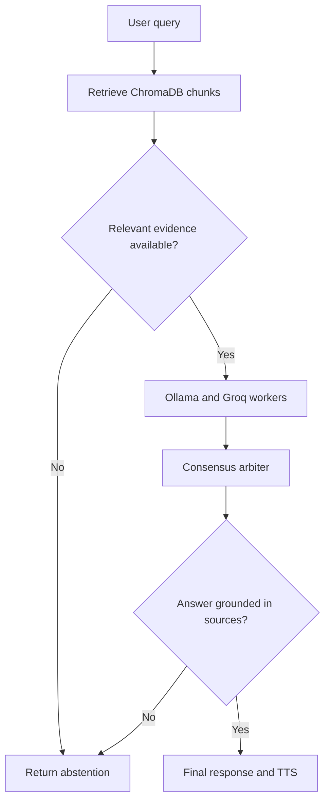

# 🤖 RagObot: Multi-Agent Concurrent RAG Matrix
RagObot was Built by Bimal P B

RagObot is a headless, highly optimized multi-agent Retrieval-Augmented Generation (RAG) system built with **LangGraph**. It orchestrates local compute (**Ollama**) and cloud compute (**Groq LPU**) concurrently, strictly monitors rolling context window budgets, displays live thought calculations on a futuristic **React Cyber-Console** (or interactive terminal console via **Rich**), and dispatches final responses to native Windows Text-to-Speech via **WinSDK SAPI** (with toggleable browser Web Speech).

---

## 🗺️ System Architecture & Workflow



---

## 🛠️ Core Pillars & Implementation

1. **Fail-Closed Concurrency Orchestration Layer (`langgraph`)**:
   - Follows strict evidence validation and factual grounding gates (`mermaid-diagram.png`).
   - `START` routes to `Retrieve ChromaDB chunks` with context-aware query reformulation and upload-document targeting.
   - **Relevant evidence available?**: Evaluates retrieved chunks strictly. If evidence is missing, below threshold (0.45), or the evaluator is unavailable, the pipeline **fails closed** to `Return abstention` (no fail-open similarity-only bypasses).
   - **Ollama and Groq workers**: Executes concurrent compute nodes (`ollama_worker` & `groq_worker`) in parallel via `asyncio`. Worker streams are quarantined behind the validation boundary during computation to prevent unverified content leaks.
   - **Consensus Arbiter**: Impartial arbitrator evaluates blinded candidate perspectives with randomized presentation order against verified source chunks. If arbiter models fail or time out, the system fails closed to abstention instead of fabricating fallback claims.
   - **Answer grounded in sources?**: Multi-layer factual grounding validation:
     - Delimits source evidence in `<untrusted_source_evidence>` tags to defend against prompt injection.
     - Runs deterministic claim verification on numbers, dates, and metrics against source text.
     - Subjected to independent secondary revalidation if answers are pruned under `PARTIALLY_SUPPORTED`.
     - Any residual unsupported claims immediately route to `Return abstention`.
   - **Final response and TTS**: Dispatches the verified, grounded response to native Windows SAPI TTS and UI.
   - Ingestion protocol reads structured Markdown (`.md`) files using `MarkdownHeaderTextSplitter` to retain semantic header hierarchy (`#`, `##`, `###`).
2. **Dual-Engine Compute Matrix (`groq` + `ollama`)**:
   - **Groq Cloud Engine**: Powered by `ChatGroq` (`llama-3.3-70b-versatile`) as the structural supervisor.
   - **Ollama Local Matrix**: Powered by `ChatOllama` (`llama3.2:3b` / `llama3`) for localized verification.
3. **Consensus Arbiter & Grounding Boundary**:
   - Worker generation streams remain internal during execution; only verified consensus responses reach the primary conversation stream. Audited candidate drafts and cross-examination notes are accessible for post-run inspection in the 2-Window Debate Arena.
   - Source citations emitted to the client are traceable directly to the exact chunks evaluated in the completed graph state.
4. **Context Window & Token Budget Management**:
   - Guarded by `trim_messages()` with `strategy="last"` and `include_system=True`.
   - Prunes history when total tokens exceed `MAX_CONTEXT_TOKENS` (default: 2,000) while permanently anchoring system RAG rules.
   - Live visual alert badge activates whenever trimming occurs.
5. **Headless Native Hardware Voice Pipeline (`win32com`) & Hybrid Web Speech**:
   - Dispatches synthesized text directly to Windows SAPI SpVoice asynchronously (`SVSFlagsAsync`) with zero UI lag.
   - React UI also features toggleable browser Web Speech synthesis for direct tab audio.
6. **Cyber-Console React Web UI (`frontend/`)**:
   - Glassmorphic cyberpunk aesthetic with neon glowing borders, dynamic thought streams, and real-time Server-Sent Events (SSE).
   - Side-by-side stream columns for Ollama (Cyan) and Groq (Yellow) in real time.
   - Live rolling token budget gauge bar with automatic pruning alerts.
   - Retrieved Markdown boundaries viewer with breadcrumbs and similarity scores.

---

## 🚀 Getting Started

### 1. Install Backend Dependencies
```powershell
.venv\Scripts\pip install -r requirements.txt
```

### 2. Configure Environment
Copy `.env.example` to `.env`:
```powershell
copy .env.example .env
```
Add your Groq API key and preferred models in `.env`.

### 3. Run the Backend API (FastAPI)
```powershell
.venv\Scripts\python -m uvicorn api:app --reload --port 8000
```

### 4. Run the React Frontend
In a new terminal window:
```powershell
cd frontend
npm install
npm run dev
```
Open **`http://localhost:5173`** in your browser.

*(Optional)* You can also still run the pure terminal cyber-console anytime:
```powershell
.venv\Scripts\python main.py
```
